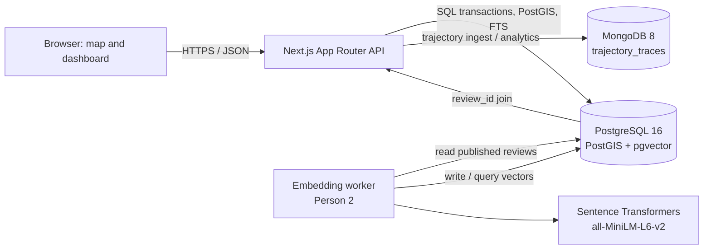

# Geospatial Intelligence Platform — database architecture

## Scope and system shape

This describes the existing Next.js + TypeScript App Router application and the implemented PostgreSQL schema. PostgreSQL/PostGIS is the system of record for users, places, categories, opening hours, reviews, check-ins, and audit events. MongoDB stores high-volume, timestamped GPS trajectories and movement-oriented documents. pgvector stores derived review embeddings adjacent to the authoritative PostgreSQL reviews; embedding generation remains Person 2's responsibility. No cross-database foreign keys or distributed transactions are assumed.

## Database responsibilities

### PostgreSQL and PostGIS

Authoritative relational store for UUID users/roles, place identity and WGS84 location, category hierarchy and assignments, local-time opening schedules, reviews/ratings, check-ins, audit events, and relational aggregates. PostGIS geography expresses earth locations in meters and supports radius search. SQL views/functions can provide reusable aggregates and query semantics. PostgreSQL transactions enforce relational invariants.

### PostgreSQL full-text search and pgvector

Review text remains in `reviews`. A generated `tsvector` plus GIN index supports keyword search. A one-to-one `review_embeddings` table holds a derived 384-dimensional vector, model revision, and source-text hash. HNSW cosine search returns review IDs, which are joined back to PostgreSQL for authorization, moderation, place/category, and detail fields.

### MongoDB

Person 2 owns the GPS trajectory document collection and movement analytics. Each trace has a UUID string `_id`, a UUID string `userId` that references (without an enforceable cross-store FK) PostgreSQL, a device UUID/metadata, UTC trace times, and ordered timestamped point samples. Mongo aggregation computes movement summaries without expanding the relational schema with high-frequency samples.

## Data flows

1. The browser sends a nearby-search request to a server API with center coordinates, a bounded radius, and optional category/rating/open-time filters.
2. The API validates user input and runs parameterized PostgreSQL queries. `ST_DWithin` uses the GiST geography index to reduce candidates; `ST_Distance` orders results by meters. Rating aggregates and opening-hours predicates are applied using current published reviews and the place's IANA timezone.
3. Review writes, ratings, and any corresponding audit event run in a PostgreSQL transaction. Keyword search uses PostgreSQL text search. Semantic search embeds the natural-language query in the same model space, finds candidate review IDs with pgvector, then joins authoritative review/place rows and filters unpublished content.
4. GPS ingestion validates ownership and payload bounds, writes a trajectory document to MongoDB, and returns its trace UUID. Analytics aggregate ordered samples by user/device/time window. Cross-store consistency is eventual; retries must be idempotent.
5. Dashboard endpoints query SQL aggregates and Mongo aggregation results independently, label their freshness, and combine them in the API. They do not pretend to be a single distributed snapshot.

## Technology choices and rationale

- **PostgreSQL 16:** relational constraints, transactions, SQL aggregation, mature indexing, and extensions in one local service.
- **PostGIS `geography(Point,4326)`:** stores longitude/latitude as WGS84 earth locations, lets radius inputs use meters, and uses a GiST index. Raw coordinates pass through `checked_geography_point(lon,lat)` because the geography cast can normalize out-of-range longitude values. A projected `geometry` could be faster for a single local region, but would require selecting/managing an appropriate CRS and transformations; geography is the project default.
- **Normalized relational model:** category assignment is a junction; opening schedule and embeddings have separate tables; average rating/distance are derived. This reduces update anomalies and preserves source values.
- **MongoDB:** flexible trace/session shape and aggregation for ordered, high-volume GPS samples. Bound document size and define retention before production volume grows; one document per whole trip may require chunking for long traces.
- **pgvector:** keeps semantic candidates joinable to reviews and applies relational filters in the same PostgreSQL query. The selected local English model is `sentence-transformers/all-MiniLM-L6-v2` with 384 dimensions; evaluate representative query relevance and pin an immutable model revision before generating vectors. ([Model card](https://huggingface.co/sentence-transformers/all-MiniLM-L6-v2))
- **Keyword search:** native PostgreSQL `tsvector`/GIN avoids another search service for the project scope. If multilingual/stemming requirements exceed the selected text-search configuration, revisit it.

## ER design

See [`er-diagram.mmd`](er-diagram.mmd) for the Mermaid ER diagram and [`data-dictionary.md`](data-dictionary.md) for every implemented relational column, type, key, check, default, index, delete rule, and database function. The core relationships are user-to-reviews/check-ins, place-to-reviews/check-ins, categories-to-places through `place_categories`, optional one-to-one place-hours profile, and optional one-to-one review embedding. Category hierarchy is self-referential. `audit_logs.resource_id` is intentionally polymorphic and cannot use a normal FK.

## Advanced DBMS concept mapping

| Concept | Planned location | Why it is useful | Test/demo and evidence |
|---|---|---|---|
| PostGIS spatial indexing | GiST index on `places.location` | Narrows geographic candidates efficiently. | `database/tests/verify.sql` runs `EXPLAIN (ANALYZE, BUFFERS)` with sequential scans disabled for a controlled demonstration; production planner behavior remains cost-based. |
| Spatial radius query | `nearby_places()` SQL function | Meter-radius filtering, distance sort, category and minimum-rating filters. | Verification checks a known-origin result and radius/distance; `database/queries/nearby_places.sql` demonstrates a 5 km call. |
| Transactions, commit, rollback | Review + audit write pattern demonstrated in verification | Prevents a review being persisted without its related audit event. | Verification commits both rows, checks them, removes the test records, then forces an invalid rating inside a subtransaction and asserts neither row survives. |
| SQL views | `published_place_rating_summary` | Reuses published-review counts/averages while keeping aggregates derived. | Verification compares seeded count for a known place; the regular view updates immediately as reviews change. |
| Triggers and functions | `set_updated_at`, deferred weekly-hours validation, `audit_admin_change`, `place_is_open()`, `nearby_places()` | Keeps timestamps, schedule invariants, admin audit events, and reusable query behavior in PostgreSQL. | Verification checks known/unknown/closed hours and updates a place under an admin session context, then verifies and rolls back its audit row. |
| MongoDB aggregation pipelines | Person 2 trajectory analytics | Computes per-trace/day/user distance, speed, point count, activity windows. | Feed controlled test traces; pipeline `$unwind`, `$sort`, derive consecutive point deltas, `$group`; compare output with a small hand calculation and inspect explain/index use. Avoid claiming road distance from raw straight-line GPS. |
| pgvector similarity search | `review_embeddings` and semantic review service | Finds conceptually related reviews beyond exact keywords. | Store embeddings from fixed revision; embed a fixed query with that same revision; run cosine `<=>` top-k and show IDs/scores joined to only published reviews. Compare a small relevance-labeled query set. |
| PostgreSQL full-text search | Generated `reviews.search_document` + GIN | Efficient lexeme search with ranking and no extra service. | Run `websearch_to_tsquery('english', ...)`, filter with `@@`, rank by `ts_rank`; compare expected matches and show `EXPLAIN` using GIN at representative volume. |

## Implementation verification record

Verified against the running local PostgreSQL 16.15 instance (PostGIS 3.7.0 and pgvector 0.8.7). The migration was reapplied successfully; the seed script loaded 5 users, 8 categories, 20 places, 22 category assignments, 32 reviews, and 5 check-ins, then reran with zero duplicate rows inserted. The full `database/tests/verify.sql` run passed table/PK/FK/index checks, uniqueness and invalid-input checks, spatial/category/rating searches, distance, open/closed/unknown states, view and full-text assertions, the admin audit triggers, and transaction commit/rollback checks.

The captured spatial plan used `Index Scan using places_location_gist_idx`, with `ST_DWithin` in the filter and five matching seeded places. On this small dataset the plan demonstration used `SET enable_seqscan=off`; the final observed execution was 0.075 ms, a test result rather than a production performance claim. The documented nearby-place and keyword-search SQL examples also ran successfully. No review embeddings were generated; only the vector column and HNSW index exist.

## Security, privacy, and operations

- Store only Argon2id password hashes and keep authentication/authorization on the server. Enforce `admin`/`user` permissions in API/service code; never trust role values from the browser.
- Use parameterized SQL and Mongo filters, input bounds, UUID validation, and output escaping. Restrict DB credentials by service; local bootstrap/root credentials are development-only. Production must use least-privilege roles, managed secrets, TLS, backups, and network controls.
- GPS traces are sensitive location histories. Collect only with consent, minimize device metadata, define retention/export/deletion rules, restrict access by owner/admin, encrypt transport/storage, and avoid raw coordinates in logs or audit details.
- Reviews may contain personal data. Apply moderation/retention policy, avoid embedding hidden reviews into public results, protect vector access like review access, and delete/regenerate embeddings when source text changes or is erased.
- Audit logs should exclude credentials, tokens, full request payloads, and raw GPS. Limit visibility and define retention.
- Back up PostgreSQL and MongoDB independently and test restoration. A Compose volume provides persistence across container recreation, not a backup or disaster-recovery plan.

## Remaining implementation decisions

1. The schema now enforces half-star increments and permits rating-only reviews. Special holiday schedules remain deferred; weekly schedules are validated as complete, non-overlapping intervals.
2. Confirm supported review languages. Pin a specific model commit and inference runtime in Person 2's module before embedding generation.
3. Decide GPS retention, consent, user export/deletion behavior, maximum sampling rate/trace length, and whether long traces require chunking or MongoDB time-series collections.
4. Define review edit/moderation/audit retention and account-erasure policy. Current FK actions preserve review history while nulling user references.
5. Establish expected row counts and query load before tuning HNSW or adding indexes.

## Recommended implementation sequence

1. Review database migrations, seed scripts, and tests in this task before using them as the project baseline.
2. Person 2 implements MongoDB schema/validation and retention/index policy against the integration contract.
3. Person 2 pins the embedding model revision, adds idempotent embedding refresh, and evaluates semantic relevance.
4. Keep DBMS demonstrations reproducible and report actual `EXPLAIN` output with its dataset/planner settings.
